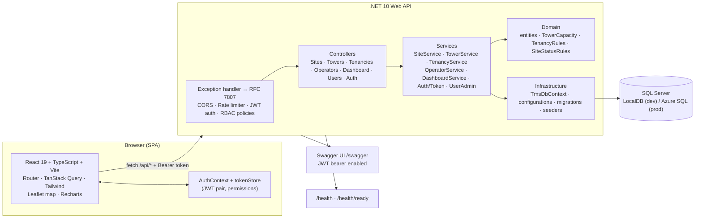
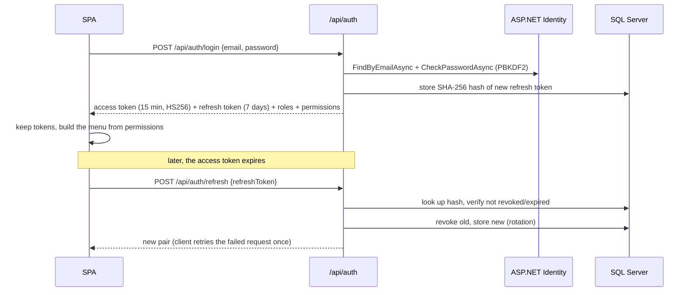

# Architecture

## Component view



## Layers

| Project | Responsibility | Notable contents |
|---|---|---|
| `Tms.Domain` | Pure business model, no framework dependencies | `Site`, `Tower`, `Operator`, `Tenancy`, enums, `TowerCapacity`, `TenancyRules`, `SiteStatusRules`, `DomainRuleException` |
| `Tms.Infrastructure` | Persistence + identity store + demo data | `TmsDbContext : IdentityDbContext`, entity configurations (indexes, precision, check constraints, filtered unique index), EF migrations, `DemoDataSeeder`, `IdentitySeeder`, `AppUser`, `RefreshToken`, design-time factory |
| `Tms.Api` | HTTP surface and orchestration | Controllers, request/response DTOs, services, `AuthService` (JWT + refresh rotation), permission/policy mapping, `ApiExceptionHandler`, Swagger, health checks, rate limiting, `DbInitializer` |
| `web/tms-web` | SPA | Login, role-filtered shell, Dashboard, Sites + detail + form, Operators, Tenancies, Users, typed API client, guards |
| `tests/*` | Safety net | 28 domain unit tests, 28 API integration tests (real pipeline + temporary LocalDB per run) |

Dependency direction is one-way: `Api → Infrastructure → Domain`. The API never talks to EF
directly except through the services, and the domain knows nothing about HTTP or SQL.

## Patterns used (and deliberately not used)

| Pattern | Where it lives here | Why |
|---|---|---|
| **Layered (n-tier) architecture** | `Tms.Domain` ← `Tms.Infrastructure` ← `Tms.Api`, SPA on top | Small enough to explain live, strict enough that the domain has no framework dependencies |
| **Service layer** | `Tms.Api/Services/*Service.cs` behind `ISiteService`, `ITenancyService`, … | One place per use case for orchestration, rules, transactions; controllers stay thin; easy to substitute in tests |
| **Domain model (DDD-lite)** | Entities with behaviour-free state + rule classes (`TenancyRules`, `SiteStatusRules`) + value object (`TowerCapacity`) | Rules are shared by API, seeder and unit tests; no aggregates/event sourcing ceremony |
| **Repository + Unit of Work** | **Not implemented as our own classes** - provided by EF Core: `DbSet<T>` is the repository, `DbContext.SaveChangesAsync` is the unit of work, the scoped `DbContext` is the per-request scope | Wrapping EF Core in `IRepository<T>` would add indirection without capability; EF Core is already an abstraction over the database, and we do not swap storage engines |
| **Transaction script (per use case)** | `TenancyService.CreateAsync` → `Serializable` transaction through `Database.CreateExecutionStrategy()` | Capacity check and insert must be atomic; the transaction boundary is visible and easy to explain |
| **DTO / contract mapping** | `Tms.Api/Contracts/*` + explicit mapping in `PortfolioMapping` | No AutoMapper: mapping is greppable and debuggable |
| **Policy-based authorization** | `Auth/Permissions.cs` + `AuthorizationPolicies.cs` | Roles → permissions in one file; UI and API share the vocabulary |
| **Options pattern** | `JwtOptions` bound from `Jwt:*` (+ Key Vault in Azure) | Configuration validated where it is used |
| **Middleware / cross-cutting handlers** | `ApiExceptionHandler` (RFC 7807), rate limiter, health checks, CORS | Consistent errors and ops probes without polluting controllers |
| **CQRS / MediatR, microservices, event sourcing** | **Not used** | Out of scope for a 4-use-case system; would add moving parts to explain without solving a real problem here |
| **AutoMapper, generic `IRepository<T>`, specification pattern** | **Not used** | Deliberate: fewer layers to read in a live walk-through, no query-object indirection over LINQ |

> If the data access needed to change (second data source, event-sourced read models, a non-EF
> store), the seam to introduce is a repository **per aggregate** used by the services
> (`ISiteRepository.GetForCapacityAsync`, `ITenancyRepository.AddAsync`) - the controllers and
> contracts would not change, because they already depend on service interfaces rather than EF.


## Request flow: assigning a tenant (use case 2)

```mermaid
sequenceDiagram
    participant U as Commercial user
    participant SPA as React SPA
    participant API as TenanciesController
    participant SVC as TenancyService
    participant DB as SQL Server

    U->>SPA: open site, click "Assign tenant"
    SPA->>API: POST /api/tenancies (Bearer JWT)
    API->>API: authorize policy Tenancies.Manage
    API->>SVC: CreateAsync(request)
    SVC->>DB: BEGIN TRANSACTION (Serializable)
    SVC->>DB: load tower + site + active tenancies
    SVC->>SVC: TenancyRules: site Active? capacity free? duplicate? rent > 0? term valid?
    alt rule violated
        SVC-->>API: DomainRuleException(code)
        API-->>SPA: 409 ProblemDetails { code, detail }
        SPA-->>U: red banner with the exact reason
    else accepted
        SVC->>DB: INSERT tenancy; COMMIT
        SVC-->>API: TenancyDto
        API-->>SPA: 201 Created
        SPA->>SPA: invalidate site/dashboard queries → capacity bar moves
    end
```

## Authentication and RBAC



* **Identity** owns users, password hashing, lockout (5 attempts / 5 min) and unique e-mail.
* **JWT** is issued and validated by the API (`Microsoft.AspNetCore.Authentication.JwtBearer`),
  signed with `Jwt:SigningKey` - appsettings for dev, App Setting / Key Vault in Azure. Startup
  fails fast if the key is missing or shorter than 32 characters.
* **Refresh tokens** are random 48-byte values, stored only as SHA-256 hashes, rotated on use and
  revocable on logout. Replaying a used token returns `401`.
* **Permissions → policies** live in `Tms.Api/Auth`:

| Permission | Admin | Operations | Commercial | Manager |
|---|:--:|:--:|:--:|:--:|
| `Portfolio.View` (site/operator/tenancy lists, site detail) | ✅ | ✅ | ✅ | ✅ |
| `Dashboard.View` | ✅ | ✅ | ✅ | ✅ |
| `Sites.Manage` (create/update/status/delete) | ✅ | ✅ | – | – |
| `Towers.Manage` | ✅ | ✅ | – | – |
| `Operators.Manage` | ✅ | – | ✅ | – |
| `Tenancies.Manage` (assign/update/terminate) | ✅ | – | ✅ | – |
| `Users.Manage` | ✅ | – | – | – |

* The **API is the authority**: controllers declare `[Authorize(Policy = Permissions.X)]`, and a
  wrong role gets `403` even if the SPA were bypassed.
* The **menu follows the role**: `GET /api/auth/me` returns `permissions[]`, and
  `web/tms-web/src/components/Layout.tsx` filters `navItems` (each item declares the permission it
  needs). Buttons ("Register site", "Assign tenant", "Users") use the same check, so a Manager sees
  a read-only app and the `/users` route renders a 403 page.
* Credential endpoints are rate limited per client IP (fixed window, 10/minute by default,
  configurable via `RateLimiting:AuthPermitLimit`).


## Data access

* One `DbContext` for portfolio **and** identity (`IdentityDbContext<AppUser, IdentityRole<Guid>, Guid>`
  with friendlier table names: `Users`, `Roles`, `UserRoles`, …). One migration history, one
  connection string - simple to host on Azure SQL.
* Explicit `IEntityTypeConfiguration` per aggregate: max lengths, `decimal(18,2)` precision, enums
  as strings, UTC `datetimeoffset` timestamps, indexes on `Site.CountryCode`, `Site.Status`,
  `Tower.SiteId`, `Tenancy.TowerId/OperatorId/Status`, unique indexes on business keys, a filtered
  unique index for "one active tenancy per operator per tower", and
  `CK_Towers_TenantCapacity: TenantCapacity >= 1`.
* Audit timestamps (`CreatedAtUtc`, `UpdatedAtUtc`) are stamped in the `SaveChanges` overrides for
  every `AuditableEntity`.
* List queries project **aggregates in SQL** (`Sum`, `Count`, `Any`, `OrderBy` on a computed
  utilisation ratio) so paging and sorting stay server-side; only the page of results is
  materialised.
* Assigning a tenancy uses `Database.CreateExecutionStrategy()` + a `Serializable` transaction - the
  correct EF Core pattern when `EnableRetryOnFailure` is configured.
* Migrations are applied at startup when `Database:AutoMigrate=true` (dev/demo); production uses
  `dotnet ef migrations script --idempotent` from the deployment pipeline (see the Azure doc).

## Error model

Every error the SPA receives is RFC 7807 `application/problem+json`:

```json
{
  "type": "https://httpstatuses.io/409",
  "title": "Business rule violated",
  "status": 409,
  "detail": "Tower DE-HAM-0087-T1 is fully utilized (4/4 tenant slots in use). Terminate an existing tenancy or increase the tower capacity before assigning another operator.",
  "instance": "/api/tenancies",
  "code": "tower_capacity_exceeded"
}
```

| Exception | Status | `code` |
|---|---|---|
| `DomainRuleException` (`IsConflict = true`) | 409 | rule code, e.g. `tower_capacity_exceeded` |
| `DomainRuleException` (`IsConflict = false`) | 400 | e.g. `invalid_tenancy_term` |
| `KeyNotFoundException` | 404 | `not_found` |
| `UnauthorizedAccessException` | 401 | `unauthorized` |
| Model validation failure | 400 | `ValidationProblemDetails` with field errors |

The SPA's `ApiError` keeps `status`, `detail`, `code` and `errors`, so forms can highlight fields
(`errors`) and modals can explain business rules (`detail` + `code`).


## Frontend architecture

```
src/
├─ api/        client.ts (fetch + bearer + silent refresh + problem parsing), api.ts (typed endpoints), types.ts (DTOs)
├─ auth/       AuthContext (session + permissions), tokenStore, guards (RequireAuth, RequirePermission)
├─ components/ Layout (role-filtered nav), Feedback (banners/spinner/empty), Badges (status, capacity bar), Modal/Field/Pagination, 403/404
├─ features/   auth · dashboard (KPIs + Leaflet map + Recharts) · sites (list/detail/form/assign-tenancy) · operators · tenancies · users
└─ lib/        format helpers (currency, percent, DateOnly-safe dates, utilisation tone)
```

* **Server state** is handled by TanStack Query: one query key per resource
  (`['sites', filters]`, `['site', id]`, `['dashboard']`, …) and mutations invalidate exactly the
  keys they affect, so assigning a tenant refreshes the site detail, the list and the dashboard.
* **Session state** lives in `AuthContext`; `client.ts` attaches the bearer token and performs
  **one** silent refresh-and-retry on `401` before clearing the session, using a shared in-flight
  promise so parallel requests do not stampede the refresh endpoint.
* **Route guards** mirror API policies: `RequireAuth` (session) and `RequirePermission` (per area),
  plus a 403 page naming the missing permission and the user's roles.
* **Styling** is Tailwind CSS v4 with a small set of component classes (`.card`, `.btn-primary`,
  `.input`, `.th`, `.td`) defined once in `index.css` - consistent UI without a heavy component
  library.

## Configuration

| Key | Dev value | Notes |
|---|---|---|
| `ConnectionStrings:Default` | LocalDB `TowerManagementDb` | Azure: `ConnectionStrings__Default` with `Encrypt=True`, or a Key Vault reference |
| `Jwt:SigningKey` | dev-only key (checked in, clearly labelled) | Azure: App Setting / Key Vault reference, ≥ 32 chars; startup fails fast otherwise |
| `Jwt:Issuer` / `Jwt:Audience` | `TowerManagementSystem` / `…Client` | Must match between issuing and validation |
| `Jwt:AccessTokenMinutes` / `RefreshTokenDays` | 15 / 7 | |
| `Cors:AllowedOrigins` | `http://localhost:5173`, `:4173` | Azure: the SPA origin(s) |
| `Database:AutoMigrate` / `SeedDemoData` | `true` / `true` | Set both to `false` for a managed production database |
| `Swagger:Enabled` | `true` | Swagger UI at `/swagger`; keep for the demo, protect/disable per environment in real production |
| `RateLimiting:AuthPermitLimit` | 10 per minute per IP | Raised in integration tests |

## Decisions and trade-offs

| Decision | Why | Cost / trade-off |
|---|---|---|
| Rows are the truth, capacity is derived | Impossible for counters to drift; one code path for capacity logic | A few aggregate subqueries per list page (fine at TowerCo scale, indexable later) |
| Domain rules in the domain project | Same rules for API, seeder and tests; easy to explain live | Slightly more files than `if` statements in controllers |
| ASP.NET Core Identity + self-issued JWT | Mature hashing/lockout, no external identity server to host | We own the token endpoints and rotation logic |
| Permissions as policies (not scattered role checks) | One file to change who can do what; UI and API share the vocabulary | One extra indirection to explain |
| Refresh token in `localStorage` | Survives a page refresh with zero plumbing, good for a demo | XSS-exposed; production hardening is an HttpOnly + Secure cookie |
| Controllers (not minimal APIs) | Easier to walk through, familiar to reviewers, good Swagger output | Slightly more ceremony per endpoint |
| SQL Server instead of SQLite | Requirement: host on Azure SQL; same provider locally removes "works on my machine" | LocalDB must be installed (present here) |
| No AutoMapper / no repository layer | Explicit, greppable mapping; EF Core already abstracts the database | More mapping code, less magic |
| SPA served separately in dev (Vite proxy) | Fast feedback, no CORS surprises locally | Production needs `wwwroot` hosting or a CORS allow-list (documented) |

## Security notes

* Passwords: Identity PBKDF2 hashing, 8+ chars with upper/lower/digit, lockout after 5 failed
  attempts. Demo credentials are obviously demo-grade and documented.
* Tokens: 15-minute access tokens; refresh tokens hashed, rotated and revocable; `401` on replay.
* Transport: HTTPS only in Azure (App Service TLS); local dev stays HTTP for simplicity.
* Authorisation is enforced server-side on every endpoint; SPA guards are UX, not security.
* `/swagger` should be protected or disabled outside demos; the demo reset endpoint is
  Development-only and Admin-only.

## What I would do next

1. Refresh token in an HttpOnly cookie + CSRF protection (and logout-everywhere).
2. Audit trail (who changed which site/tenancy, before/after) surfaced on the site page.
3. Route-level code splitting to cut the ~890 kB bundle (Leaflet/Recharts per route).
4. Server-side search/pagination for operators and tenancies; CSV export of the portfolio.
5. Antenna mount tracking per tenant and a leasing pipeline (prospect → contract) so capacity is
   forecast as well as reported.
6. CI pipeline: `dotnet test`, `npm run build`, EF idempotent migration script, App Service deploy.
