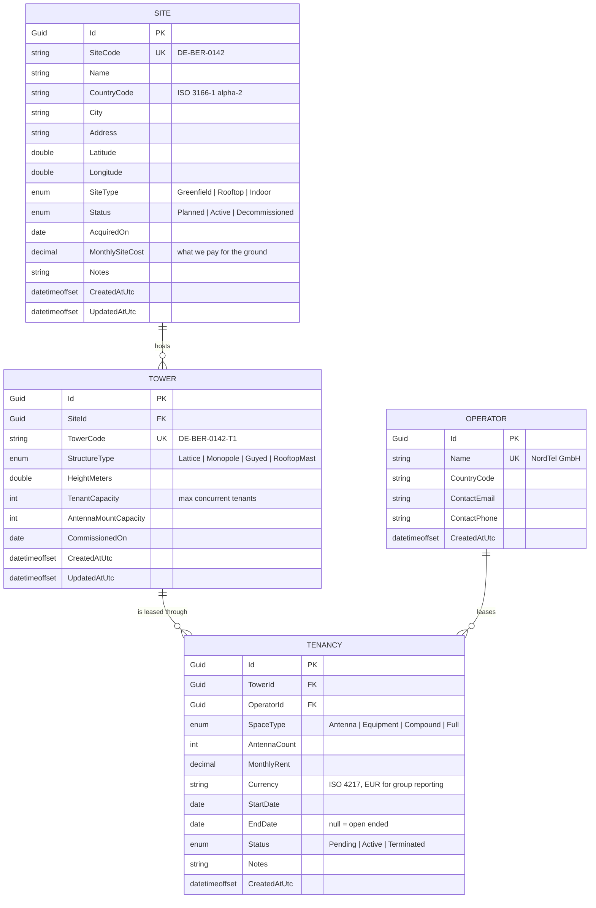

# Domain model

TowerCo owns **sites**. A site hosts one or more **towers**. A **tower** has a finite number of
**tenant slots** and leases them to **operators** (MNOs) through **tenancies**. That four-entity
model is the smallest one that answers every question in the brief: where our assets are, what is
on them, who pays for what, and how much capacity is left to sell.

## Why these entities (and not others)

| Decision | Reasoning |
|---|---|
| **Site and Tower are separate** | A site is a physical location with coordinates, ground lease cost and a lifecycle; a tower is the leasable steel asset with structure, height and capacity. One site can host two towers (the seed has several), and towers are replaced independently of the site. |
| **Operator is its own entity** | Tenants are companies that can lease many towers; the directory (contact details, home market, revenue) is a commercial asset in itself. |
| **Tenancy is a first-class entity** | Rent, term, space type and status are per lease, not per tower. It also gives us the history (terminated tenancies stay as a record). |
| **Capacity on the Tower** | "How many operators can be active here" is a structural property of the asset (steel, mounts, power), so it belongs to the tower. Antenna mount count is tracked separately because a tenant can use several mounts. |
| **Enums stored as strings** | Readable in SQL, stable if the enum order ever changes, and safe for dashboards/reporting. |
| **Coordinates on the Site** | The map requirement (use case 4) needs a point per site, and site is the location - not the tower. |
| **Currency on the Tenancy** | Real TowerCo groups report in one currency but sign leases in the local one. The demo seeds EUR for everything and the API exposes a `currency` field so mixed-currency data would not silently break aggregation. |

## Derived values (never persisted)

| Value | Definition | Used by |
|---|---|---|
| `ActiveTenants` | count of tenancies with `Status = Active` | tower cards, capacity, dashboard |
| `AvailableSlots` | `max(0, TenantCapacity - ActiveTenants)` | "can I assign another tenant?" |
| `UtilizationPercent` | `ActiveTenants * 100 / TenantCapacity` (0 when capacity is 0) | capacity bars, map colours, KPIs |
| `MonthlyRevenue` | sum of `MonthlyRent` of active tenancies | site totals, dashboard MRR |
| `RevenueSharePercent` | operator MRR / portfolio MRR | dashboard "top tenants" |

Implementation: `Tms.Domain/Portfolio/TowerCapacity.cs` (a `readonly record struct`) so the API, the
seed data and the tests all compute capacity with the same code.

## Business rules

| Rule | Code | Failure |
|---|---|---|
| A tower cannot host more active tenants than its capacity | `tower_capacity_exceeded` | `409 Conflict` |
| An operator can hold only **one active** tenancy per tower | `duplicate_active_tenancy` | `409 Conflict` (also a filtered unique index `UX_Tenancies_ActiveOperatorPerTower`) |
| Only `Active` sites can be leased | `site_not_leasable` | `409 Conflict` |
| Site lifecycle is `Planned → Active → Decommissioned`; decommissioned is terminal | `invalid_site_status_transition` | `409 Conflict` |
| A site with active tenancies cannot be decommissioned or deleted | `site_has_active_tenancies` | `409 Conflict` |
| Tenancy end date must be on/after the start date | `invalid_tenancy_term` | `400 Bad Request` |
| Monthly rent must be > 0 | `invalid_monthly_rent` | `400 Bad Request` |
| Only active tenancies can be terminated | `tenancy_not_active` | `409 Conflict` |
| Tower capacity cannot be reduced below the current number of active tenants | `capacity_below_active_tenancies` | `409 Conflict` |
| Site code / tower code / operator name are unique | `duplicate_site_code`, `duplicate_tower_code`, `duplicate_operator_name` | `409 Conflict` |
| A user cannot deactivate themselves or drop their own Admin role | `cannot_deactivate_self`, `cannot_remove_own_admin_role` | `409 Conflict` |

All of the above live in `Tms.Domain/Rules` (tenancy + site status) or the relevant service, are
covered by unit tests, and are returned to the SPA as RFC 7807 problem details with the `code`
extension so the UI can explain the rule instead of showing a raw error.

## Where the rules are enforced (defence in depth)

1. **Request DTO validation** (DataAnnotations) - shape, ranges, required fields → `400`.
2. **Domain rules** (`TenancyRules`, `SiteStatusRules`) - business meaning → `409`/`400` with a code.
3. **Database constraints** - unique indexes (site/tower/operator codes, active tenancy per
   operator+tower), check constraint `TenantCapacity >= 1`, foreign keys with `Restrict`.
4. **Concurrency** - assigning a tenancy runs at `Serializable` isolation through EF's execution
   strategy, so two simultaneous requests for the last slot cannot both succeed.

## Seed data (what you see in the demo)

`Tms.Infrastructure/Persistence/Seed/DemoDataSeeder.cs` creates, only when the database is empty:

* **24 sites** in 6 markets (DE, NL, FR, ES, PL, GB) with realistic names, addresses and
  coordinates - 20 Active, 2 Planned, 2 Decommissioned.
* **30 towers** with structure type, height, capacity (2-4 tenant slots) and antenna mounts.
* **8 operators** (NordTel, RheinFunk, Batavia Mobile, CanalCom, Lumiere Telecom, IberiaCel, PolNet,
  Crown Mobile).
* **53 active tenancies** plus **3 terminated** ones (history), EUR rents between roughly €1.1k and
  €2.4k per month.
* Three **fully utilized** towers (`DE-HAM-0087-T1`, `NL-AMS-0011-T2`, `GB-BRS-0072-T1`) so the
  capacity rule can be demonstrated live, and two planned sites plus two decommissioned sites so
  the status rules can be demonstrated too.

Identity seeding (`IdentitySeeder.cs`) creates the four roles and the four demo users listed in the
top-level README. `POST /api/dev/reset-demo` (Development only, Admin) wipes and re-seeds the
portfolio without touching users.

